# 🚀 TangelTrader Clone

A responsive **TangelTrader Clone** built using **React.js** that provides a responsive trading and investment platform experience. The project focuses on reusable components, responsive design, React Router navigation, and modern frontend development practices.

## 🔥 Tech Stack

- React.js
- JavaScript (ES6+)
- React Router DOM
- React Hook Form
- Bootstrap 5
- HTML5
- CSS3

---

## ✨ Features

- Fully Responsive UI
- Reusable Components
- React Router Navigation
- Modern Bootstrap Layout
- Clean Folder Structure
- Login & Signup Forms
- Responsive Navbar & Footer

---

## 📄 Pages

### 🏠 Home Page

- Hero Section
- Awards Section
- Stats
- Ecosystem
- Pricing Overview
- Open Account CTA

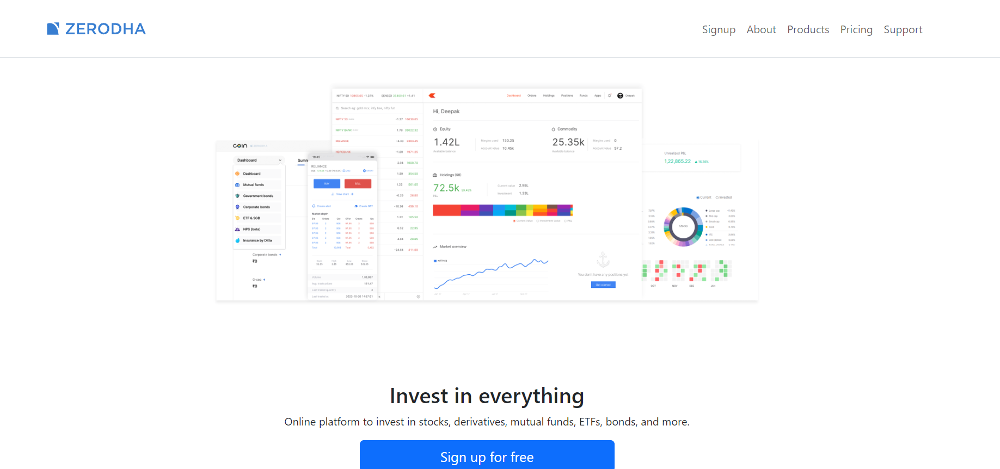

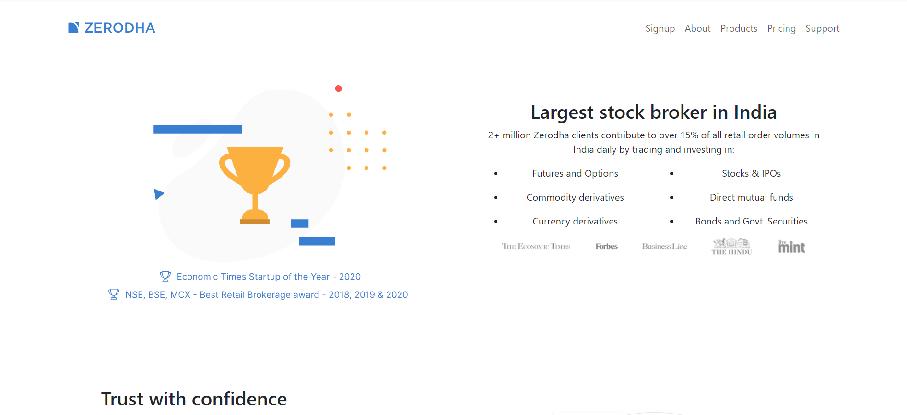

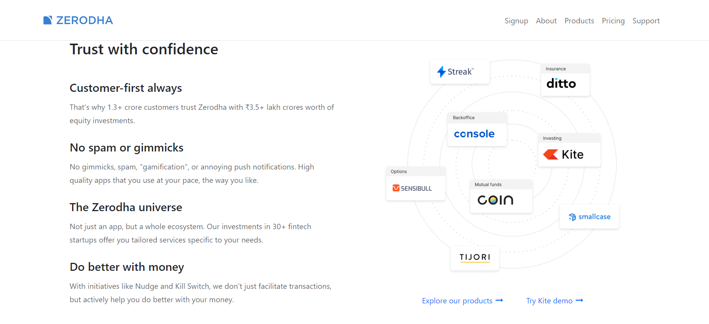

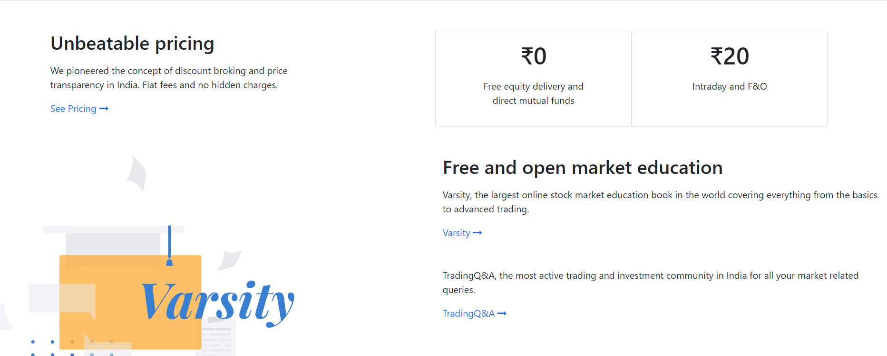

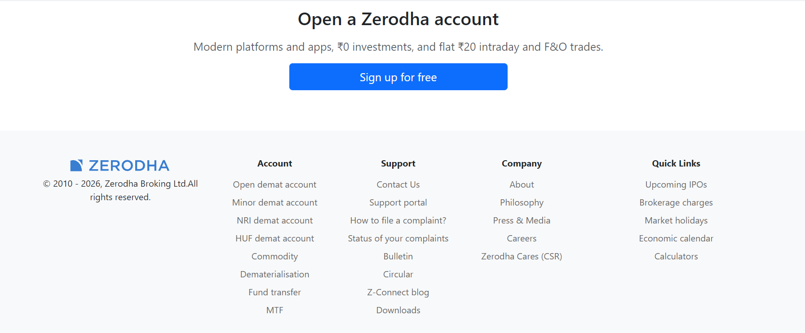

---

### 📝 Signup Page

Responsive signup form built using React Hook Form.

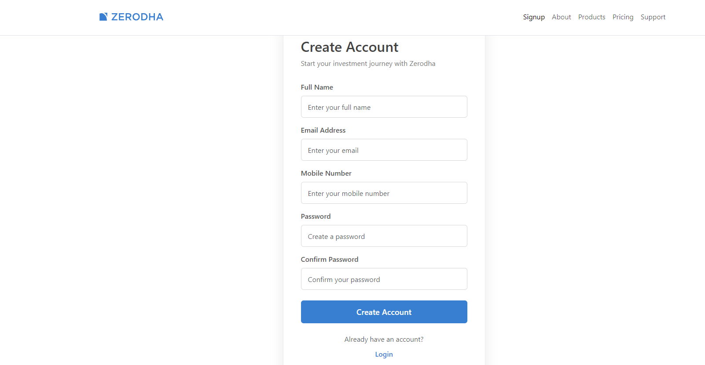

---

### 🔐 Login Page

Simple login page with responsive design.

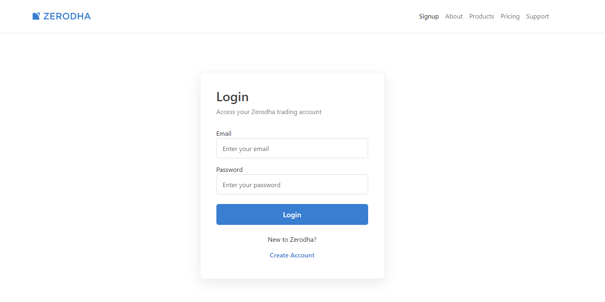

---

### 👨‍💼 About Page

Contains company information, mission, and statistics.

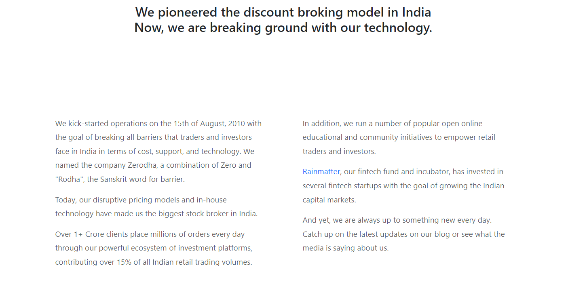

---

### 💻 Products Page

Displays TangelTrader products with reusable product components.

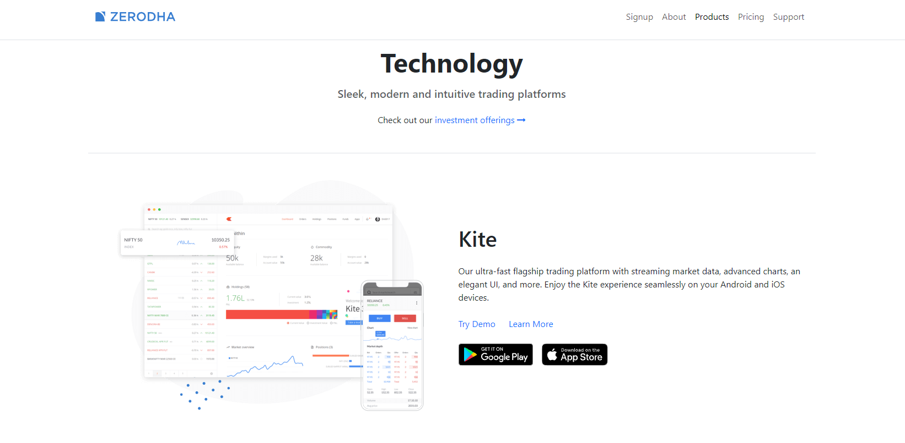

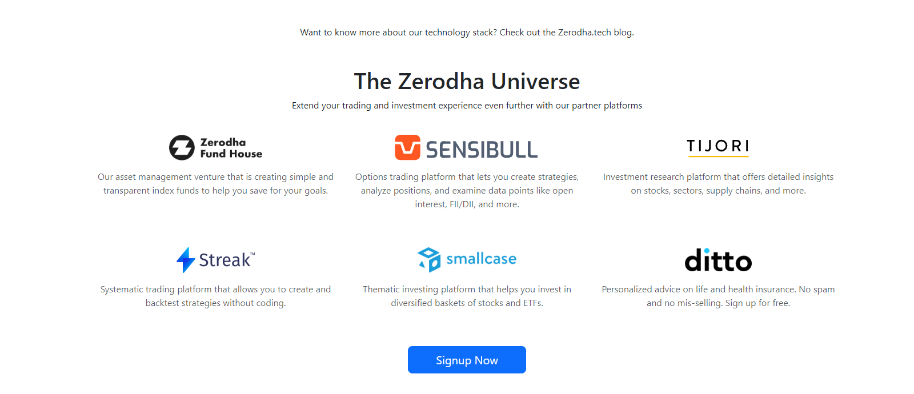

---

### 💰 Pricing Page

Responsive pricing cards and brokerage information.

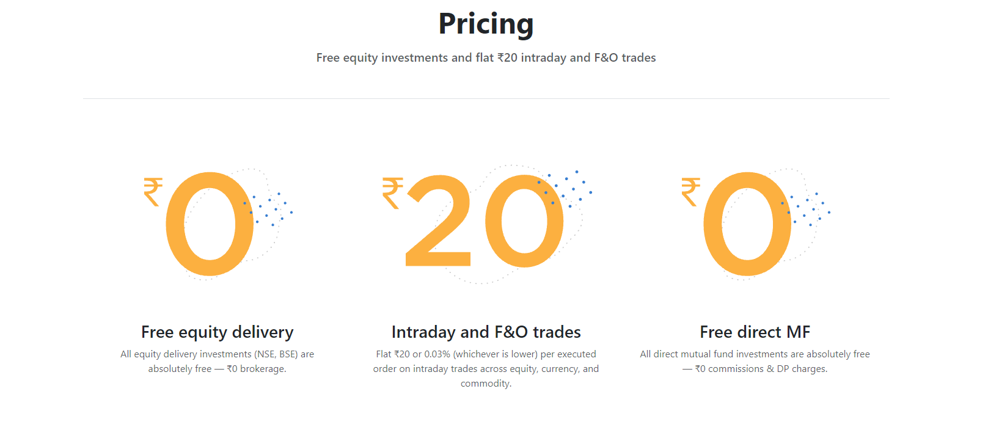

---

### 🎧 Support Page

Custom-designed support portal with responsive layout.

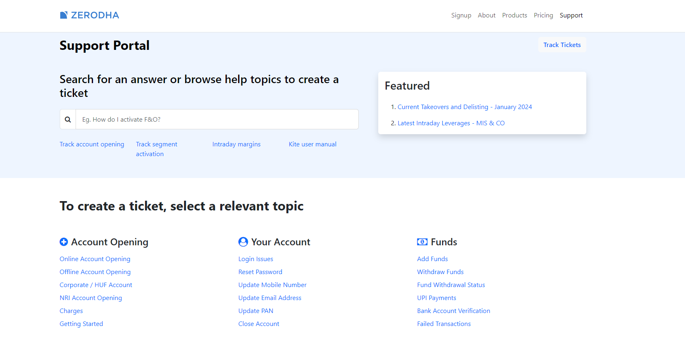

---

## 📂 Project Structure

```text
src
│
├── components
│   ├── Navbar
│   ├── Footer
│   ├── Hero
│   ├── OpenAccount
│   ├── Pricing
│   ├── Awards
│   ├── Stats
│   └── ...
│
├── pages
│   ├── Home
│   ├── About
│   ├── Products
│   ├── Pricing
│   ├── Support
│   ├── Signup
│   └── Login
│
├── App.jsx
└── main.jsx
```

---

## 🚀 Installation

Clone the repository

```bash
git clone https://github.com/your-username/tangeltrader-clone.git
```

Move to project folder

```bash
cd tangeltrader-clone
```

Install dependencies

```bash
npm install
```

Start development server

```bash
npm run start
```

---

## 🎯 Upcoming Features

- Node.js + Express Backend
- MongoDB Database Integration
- JWT Authentication
- User Signup & Login APIs
- Protected Routes
- Dashboard
- Holdings
- Positions
- Orders
- Funds
- Buy & Sell Stocks
- Portfolio Analytics
- Charts & Graphs
- Profile Management
- Watchlist
- Search Stocks

---

## 💡 Learning Outcomes

This project helped me understand:

- React Component Architecture
- Reusable Components
- React Router DOM
- Responsive Design using Bootstrap
- React Hook Form
- Project Structuring
- State Management using Hooks
- Form Validation
- Clean UI Development

---

## 📌 Future Scope

This project is currently focused on the frontend. The next phase will involve building a complete **full-stack TangelTrader platform Clone** using:

- React
- Node.js
- Express.js
- MongoDB
- JWT Authentication
- REST APIs

---

## ⭐ If you like this project, don't forget to give it a Star!
